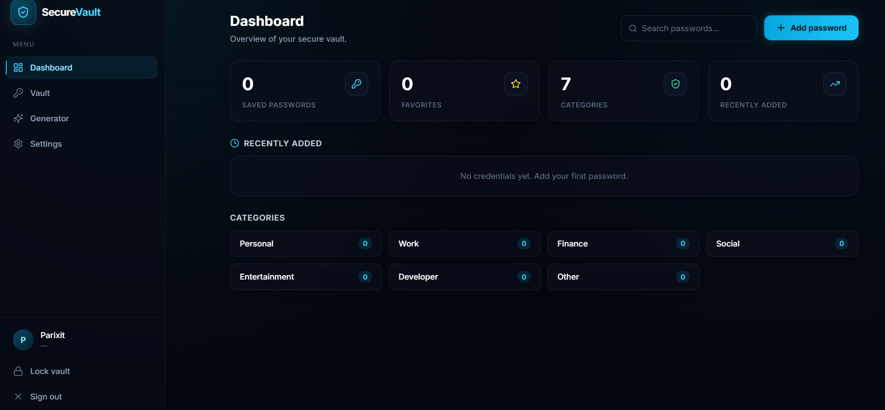
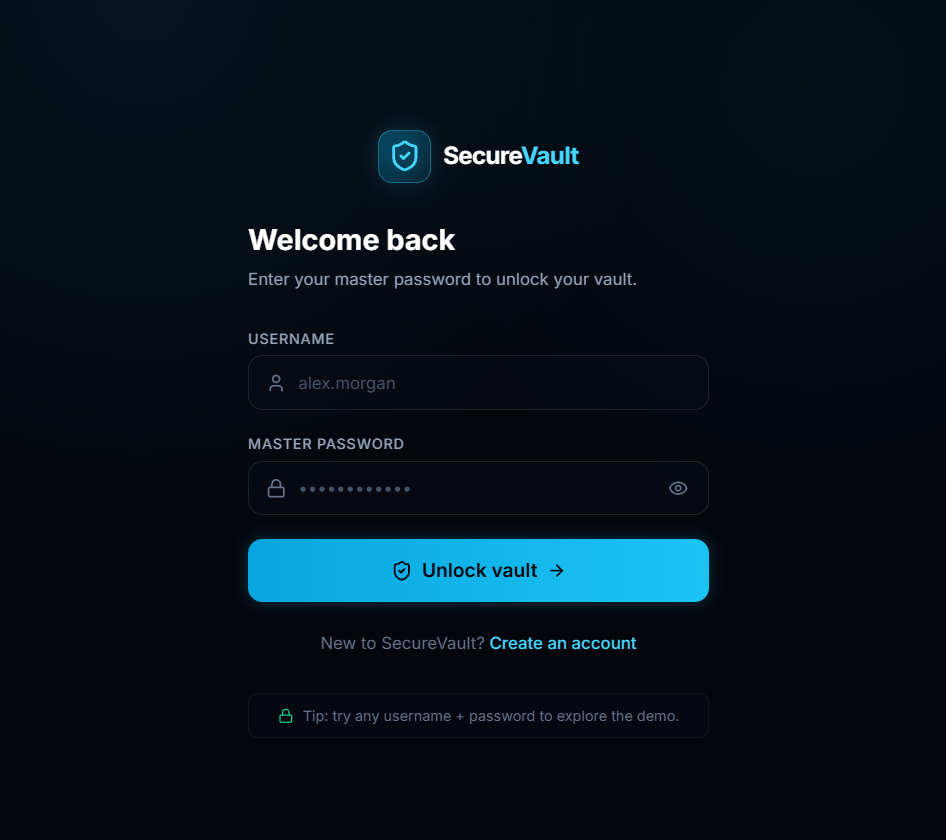
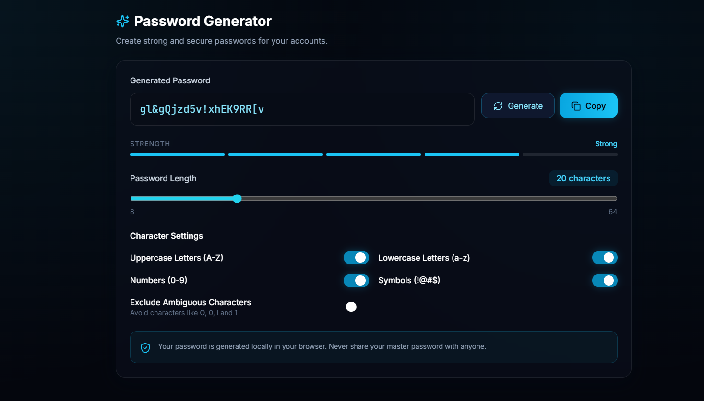
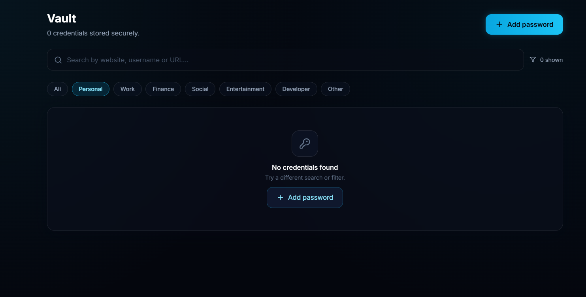

# 🔐 SecureVault – Password Manager

A secure password management application built using **Python, FastAPI, React, and TypeScript**. SecureVault helps users manage their credentials through a clean interface and encrypted credential storage.

## 🚀 Features

- 🔑 User Registration and Login
- 🔒 Encrypted Credential Storage
- 🗂️ Manage and organize saved credentials
- 🔐 Secure Password Generator
- 💪 Password Strength Indicator
- 📋 Copy credentials easily
- ⚙️ User Settings and Preferences
- ⏱️ Automatic Vault Lock

## 📸 Screenshots

### Dashboard


### Login


### Password Generator


### Password Manager


## 🛠️ Tech Stack

| Technology | Purpose |
|---|---|
| Python | Backend development |
| FastAPI | REST API |
| React | Frontend |
| TypeScript | Type safety |
| Vite | Frontend build tool |
| Tailwind CSS | UI styling |
| SQLite | Database |
| Cryptography | Credential encryption |

## 📁 Project Structure

```text
SecureVault/
├── api/
├── database/
├── frontend/
│   └── src/
│       ├── components/
│       ├── context/
│       ├── pages/
│       └── lib/
├── security/
├── services/
├── ui/
├── main.py
├── requirements.txt
└── README.md
```

## ⚙️ Installation & Setup

### 1. Clone the repository

```bash
git clone https://github.com/vishvajogani72-cmd/SecureVault.git
cd SecureVault
```

### 2. Set up Python environment

```bash
python -m venv .venv
```

Activate the environment:

**Windows:**

```powershell
.venv\Scripts\Activate.ps1
```

Install dependencies:

```bash
pip install -r requirements.txt
```

### 3. Start the Backend

```bash
uvicorn api.main:app --reload
```

Backend API: `http://127.0.0.1:8000`

### 4. Start the Frontend

Open another terminal:

```bash
cd frontend
npm install
npm run dev
```

Open the local URL displayed by Vite in your browser.

## 🔐 Security

SecureVault includes:

- Credential encryption
- Password-based key derivation
- Secure key management components
- Automatic vault locking

**Note:** This is a learning and portfolio project. It has not been independently security-audited and should not be used to store real or highly sensitive credentials.

## 🎯 Future Improvements

- Multi-factor authentication (MFA)
- Cloud synchronization
- Browser extension integration
- Security audit and penetration testing
- Improved backup and recovery functionality

## 👨‍💻 Developer

**Vishva Jogani**

B.Tech Data Science Student | Exploring Cloud Computing, Cybersecurity and Software Development.

[GitHub Profile](https://github.com/vishvajogani72-cmd)

---

⭐ If you find this project interesting, consider giving it a star!
